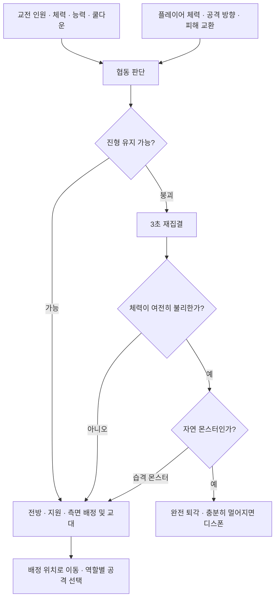

# 협동 AI 적용 및 발표 자료 확인

2026-10-14 / 협동 정책 버전 2. 코드 구현 내용이며 실제 플레이 성능 향상을 측정한 결과는 아니다.

## 바로 설명할 수 있는 내용

협동 AI는 현재 전투 상황을 보고 역할과 진형을 정하는 규칙 기반 시스템이다. 개별 AI의 학습 파일을 읽어 협동 규칙을 학습하거나 변경하지 않는다.



| 상황 | 실제로 연결한 반응 |
| --- | --- |
| 한 마리 추가/이탈 | 인원에 맞춰 Solo/Pair/Triangle/Surround 재구성 |
| 전방 부상 또는 공격 대기 | 체력·근접/범위 공격 준비 상태를 보고 역할 재평가 |
| 투사체 사용 가능한 지원 | 지원 적합도 가점, 투사체 쿨다운 15% 감소 |
| 플레이어가 전방 쪽으로 공격 | 준비된 측면 몬스터의 돌진 가중치 추가 증가 |
| 플레이어 체력 25% 이하 | 공동 공격 간격 0.65초→0.5초, 측면 돌진 압박 |
| 전방 이탈·진형 인원 급감 | 조건에 따라 3초 재집결 |
| 몬스터 평균 체력 ≤25%, 플레이어 체력 ≥60% | 재집결 후 자연 몬스터는 완전 퇴각 |
| 습격 몬스터 | 완전 퇴각 대신 재집결 후 재공격. 기존 개인 확률 퇴각도 막음 |
| 재집결 경로가 막힘 | 안전한 바깥쪽 경로 시도, 실패하면 대기 후 재판단 |

공격의 경고/실행 중이나 피격 경직 중에는 새 명령으로 강제 중단하지 않는다. 해당 단계가 끝난 뒤 명령을 수행한다. 합류/이탈 판정은 매 프레임 반영하며 일반 역할 적합도는 약 0.75초마다 다시 평가한다.

## 5번 자료는 지금 얻을 수 있는가?

| 자료 | 현재 가능 여부 |
| --- | --- |
| 모델 정의, 입력→출력, 진형 변화 규칙 | 이 문서와 Implementation.md로 바로 설명 가능 |
| 실제 학습 JSON, 행동 CSV | 플레이 후 자동 생성. 사망 개체 경험도 포함 |
| 표와 가중치/공격 그래프 | CSV가 있으면 분석 도구로 생성 가능 |
| 협동 OFF/ON 효과 비교 | 같은 조건의 두 모드 기록이 있어야 가능 |
| 학습 전/후 효과 비교 | Baseline/Frozen의 통제된 기록이 있어야 가능 |
| 시연 영상 | 실제 게임 실행 화면 촬영 필요 |

이 작업 중 확인한 `C:/Users/minsa/AppData/LocalLow/DefaultCompany/OutPost`에는 `MonsterAIResearch` 폴더와 학습 JSON이 없었다. 따라서 실제 수치나 성능 그래프를 만들어 넣지 않았다. 다른 PC/빌드 경로의 기록이 있다면 해당 세션 폴더를 분석 도구에 전달할 수 있다.

## 플레이 후 바로 꺼내는 순서

1. 게임을 실행하고 자연 생성 몬스터와 교전한다. 첫 일반 몬스터가 활성화되면 `Monster AI research`가 자동 생성된다.
2. 해당 오브젝트의 `MonsterAIExperimentModel`에서 `Show Overlay`를 켜면 학습 버전, 진형, 인원, 진형 전환 이유를 볼 수 있다.
3. `MonsterLearningPresenter` 컴포넌트의 메뉴에서 `Flush Logs and Export Current Policy`를 실행한다. `Open Research Folder`로 저장 폴더를 연다.
4. 전투 요약은 전투 종료 후 만들어진다. 플레이어 사망 또는 모든 교전이 끊긴 뒤 5초를 기다린다. 플레이를 강제 종료한 전투는 완료 전투 비교에서 제외된다.
5. 프로젝트 루트 터미널에서 실행한다.

```powershell
python Tools/MonsterAI/analyze.py --latest --output Reports/MonsterAI/latest
```

가장 최근 세션에 대한 `report.md`와 CSV 표를 얻는다. matplotlib이 설치된 Python에서는 공격 선택/명중률 그래프와 학습 배율 그래프도 만들어진다. 학습이나 전투 기록이 없으면 해당 결과를 만들지 않는다.

여러 세션 비교:

```powershell
python Tools/MonsterAI/analyze.py "<협동 OFF 세션>" "<협동 ON 세션>" --output Reports/MonsterAI/cooperation
```

협동 비교는 두 세션 모두 `Learning Mode=Baseline`, 몬스터 종류·수·스탯과 플레이어 장비·HP·행동을 맞추고 `Cooperation Enabled`만 바꾸는 방식부터 시작한다. 이 비교에는 역할 버프·공동 공격 제한·재집결/퇴각도 포함된다. 학습 효과 비교는 협동 설정을 고정하고 Baseline/Frozen을 비교한다. 새로하기로 조건을 맞추려 하면 월드 시드와 학습 기억이 초기화되므로 별도로 동일 조건을 준비해야 한다.

| 지표 | 협동 OFF | 협동 ON |
| --- | --- | --- |
| 완료 전투 표본 수 | 미측정 | 미측정 |
| 전투당 실제 직접 피해량 | 미측정 | 미측정 |
| 몬스터 교전 참여 시간 | 미측정 | 미측정 |
| 포위 유지 시간 | 미측정 | 미측정 |
| 몬스터 겹침 시간 | 미측정 | 미측정 |
| 역할 교대 수 | 미측정 | 미측정 |

현재 동작 확인용 테스트는 실제 전투 성능 데이터가 아니다. 발표에서 테스트 통과 수를 학습 효과나 협동 승률로 사용하지 않는다.
